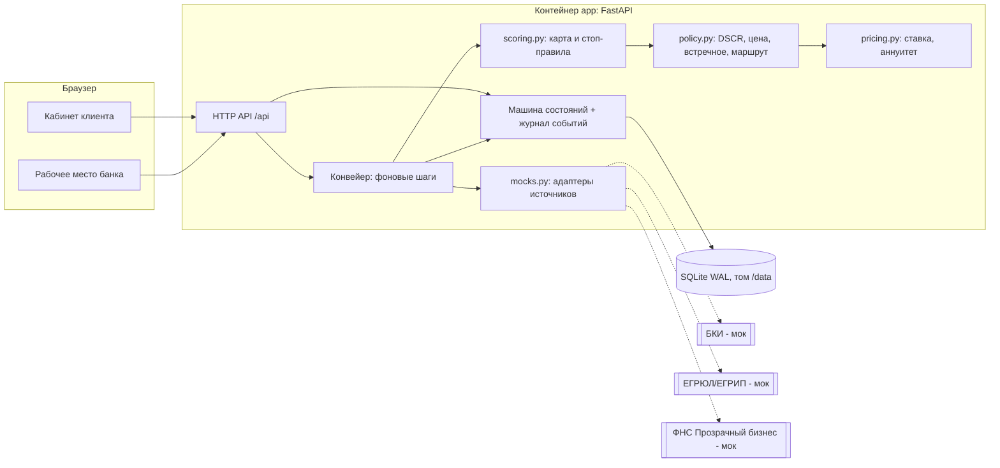
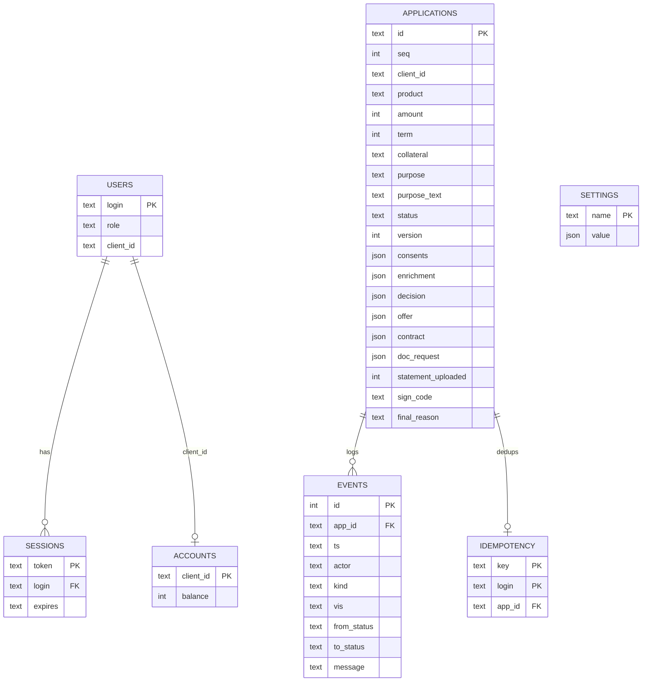

# Архитектура

## Контекст и контейнеры



Контракт между UI и бэкендом — только OpenAPI (`/openapi.json`). Статика отдаётся тем же процессом, внешних CDN нет — стенд работает без интернета.

## Последовательность: заявка клиента

```mermaid
sequenceDiagram
    participant K as Клиент
    participant A as API
    participant P as Конвейер
    participant M as Моки источников
    participant R as Аналитик
    K->>A: POST /client/applications (Idempotency-Key)
    A-->>K: 201 {id}; статус VERIFICATION
    A->>P: kick(id)
    P->>M: ЕГРЮЛ, ФНС, данные банка, БКИ (таймаут, 2 повтора)
    alt стоп-правило
        P->>A: DECLINED (причина R-код)
    else БКИ недоступно
        P->>A: MANUAL_REVIEW (деградация вместо отказа)
        R->>A: решение: одобрить / запросить документы / отказать
    else
        P->>A: DECISIONING → скоринг → политика
        A-->>K: OFFER_READY (как просили / встречное) или MANUAL_REVIEW / DECLINED
    end
    K->>A: accept → код → sign
    P->>A: DISBURSING → DISBURSED (договор, график)
```

## Модель данных



* `applications.decision` хранит снимок решения: версия карты и политики, ключевая ставка, балл, грейд, факторы, стоп-правила, флаги, платёжеспособность, рекомендацию, причины и отметку аналитика. Это журнал для аудита и воспроизведения решения.
* `events.vis`: `client` / `both` — видно клиенту; `bank` — только банку (ответы источников, повторы, ручные комментарии).
* Синтетические клиенты лежат в `mocks.py` (как «внешние» источники), а не в таблицах — банк не владеет ЕГРЮЛ/БКИ.

## Безопасность и надёжность (реализовано)

| Практика | Где |
|---|---|
| Аутентификация, роли, изоляция данных клиентов | `main.py` (`current_user`, `client_only`, `bank_only`), тест `test_access_control_and_isolation` |
| Пароли — PBKDF2-SHA256 с солью; токены сессий — `secrets`, срок 12 ч | `db.py`, `main.py` |
| Оптимистичная блокировка и запрет недопустимых переходов | `service.move` |
| Идемпотентность создания заявки | `Idempotency-Key`, тест `test_idempotency_and_single_active_application` |
| Журнал событий в той же транзакции, что смена статуса | `service.move` |
| Деградация при недоступности внешнего источника | `mocks.collect`, `service.step_verify` |
| Версии карты и политики в каждом решении | `decision.scorecard_version`, `policy_version` |
| Маскирование ИНН в списках банка, нейтральные причины отказа | `service.mask_inn`, `reasons.py` |
| Сбой автоматического шага не оставляет заявку зависшей: она уходит аналитику, в журнале банка остаётся запись | `service.run_pipeline`, `_degrade` |
| Заявки в автоматических статусах возобновляются после перезапуска процесса | `service.resume_pending`, `main.lifespan` |
| Ограничение неудачных входов (8 за 5 минут на логин), лимиты длины текстовых полей, границы суммы и срока | `main.login`, модели запросов, `service.validate_request` |
| Probes `/api/health/live` и `/ready`, healthcheck контейнера, не-root пользователь | `Dockerfile` |

## ML-слой (опционально)

`app/pd_provider.py` отдаёт PD из обученной LightGBM-модели (`MODEL_DIR`) или, если её нет, из скоркарты; `app/cascade.py` строит решение по каскаду продуктов (автоодобрение / серая зона / пропуск), оставляя жёсткие стоп-правила и допуск продукта перед моделью. Обучение и предикт — пакет `ml/` (`features`, `train`, `predict`, `synth`). Подробно: [ml.md](ml.md).

## Что заменить при выходе в прод

PostgreSQL вместо SQLite; очередь/оркестратор (Temporal/Camunda) вместо фонового потока; реальные адаптеры БКИ/ЕГРЮЛ/ФНС с теми же интерфейсами; УКЭП/Госключ вместо кода; SSO банка вместо демо-входа; хранение секретов и аудит-лог в защищённом контуре; калибровка и валидация скоринговой карты на данных банка.
