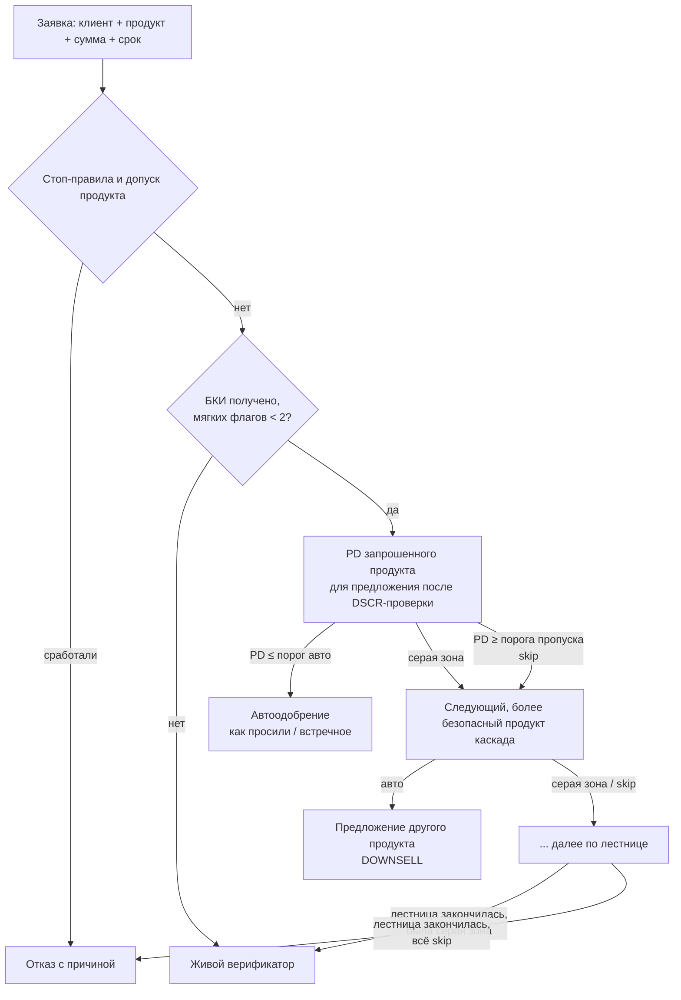

# ML-слой: PD-модель и каскад по продуктам

> **Статус.** Скрипты обучения и предикта написаны и проверены на **синтетических смоук-данных** (они проверяют, что конвейер работает, а не что модель хорошо оценивает риск). Обученной боевой модели в репозитории нет: данных банка у нас нет. Без модели система работает в режиме «скоркарта» — PD считается по ней, а каскад и всё остальное остаётся тем же.

## Идея

Одна модель на все продукты оценивает **вероятность дефолта (PD) конкретного предложения** — «этот клиент, этот продукт, эта сумма, этот срок». Над PD стоит каскад: для каждого продукта два порога делят заявки на три зоны.



* **≤ порога «авто»** → автоодобрение (с обычной проверкой платёжеспособности DSCR и встречным предложением «срок → сумма»).
* **между порогами — серая зона** → режим `grey_zone`: `downsell_then_refer` (по умолчанию) — сначала смотрим более безопасные продукты каскада и, если один проходит автоотсечку, предлагаем его; иначе заявку берёт **живой верификатор** с готовой рекомендацией. `refer` — сразу человеку.
* **≥ порога «пропуск»** → продукт пропускается и пробуем следующий; если все пропущены — отказ.
* Лестница (`ml.ladder` в `config/products.yaml`): развитие → оборотный → овердрафт; льготный → оборотный → овердрафт; оборотный → овердрафт.

Порядок «жёсткие правила → модель» намеренный: стоп-правила (банкротство, блокировка счетов, налоговая недоимка, санкции) — это *policy overlay*, модель их не отменяет. Решение трассируется: в карточке аналитика видно, какие продукты пробовались, их PD, грейд, зону, предложение и вклады признаков.

## Принципы каскада и где они в коде

* **Три маршрута, а не два.** Низкий риск одобряется автоматически, высокий отклоняется, средний уходит человеку. В серую зону обычно попадает основной объём заявок, поэтому её границы подбирают по реальному проценту плохих кредитов. Для этого `metrics.json → zones_test` показывает долю заявок и фактический bad rate в каждой зоне.
* **Порог зависит от продукта.** Оптимальная граница у разных продуктов разная (цена, срок, потери при дефолте), поэтому пороги заданы по продуктам (`ml.cutoffs`), а PD считается для суммы и срока именно этого предложения.
* **Каскад вместо немедленного отказа.** Если продукт не прошёл, заявка проверяется по более безопасным продуктам без повторной подачи. Порядок задаёт аппетит к риску (`ml.ladder`, `cascade.evaluate_cascade`). Предложение другого продукта в оффере имеет тип `DOWNSELL`.
* **Альтернативные условия вместо отказа.** Андеррайтер при высоком риске предлагает другую ставку, сумму или обеспечение, а не только отказ. Поэтому серая зона уходит живому верификатору с готовой рекомендацией, и он может изменить условия.
* **Монотонные ограничения** (`features.MONOTONE`, `monotone_constraints` в LightGBM). Они мало снижают точность, зато делают поведение модели объяснимым: рост просрочки не может уменьшить PD.
* **Калибровка** (`--calibration auto|isotonic|platt`). Вероятности бустинга обычно калибруют, но иногда это ухудшает результат, поэтому метод выбирается по данным, а в `metrics.json` лежат метрики до и после калибровки.

Определение целевой переменной «дефолт за 12 месяцев» и работа с отказанными заявками (reject inference) — стандартная практика и наше допущение: их нужно согласовать с риск-командой банка.

## Таргет: сведение к задаче бинарной классификации

* `default_12m = 1`, если за 12 месяцев после выдачи была просрочка 90+ дней; иначе `0`. Модель обучается как бинарный классификатор (`objective=binary`), выход после калибровки — **PD ∈ (0, 1)**.
* В обучение попадают только кредиты с окном наблюдения ≥ 12 месяцев (`observed_months ≥ 12`) — «незрелые» исключаются, иначе PD занижается.
* Единица наблюдения — **предложение/кредит**: признаки считаются на момент решения (ничего «из будущего»), а продукт, сумма, срок и обеспечение — тоже признаки. Поэтому одна модель покрывает все продукты, а PD отличается для разных продуктов и сумм одного клиента.
* Для шкалы, привычной банку и UI: `score = 60 + 15·log2(((1−PD)/PD)/19)` (60 баллов = PD 5 %, +15 баллов удваивают шансы; `ml.predict.pd_to_score`) — та же шкала, что у скоркарты, поэтому оценки сопоставимы.

## Признаки (ml/features.py — единый код для обучения и инференса)

| Группа | Признаки |
|---|---|
| Бизнес и данные | возраст бизнеса, стаж в банке, глубина выписки, отрасль, форма (ИП/ООО), источник выписки |
| Денежный поток (данные банка) | log среднемесячных поступлений, динамика 6/6, коэффициент вариации, min/среднее, последние 3 мес. к среднему, платежи по кредитам / поступления, log чистого денежного потока |
| БКИ (NaN, если недоступно) | наличие данных, длина истории, макс. просрочка за 24 мес., текущая просрочка, обращения за 3 мес., действующие кредиты |
| ФНС и реестры | log налоговой задолженности, её срок, иски / оборот, реестр МСП, приоритетная отрасль |
| Предложение | продукт, log суммы, срок, обеспечение, сумма / среднемесячные и годовые поступления, **платёж / денежный поток** (по индикативной ставке 20 %) |

* Пропуски БКИ — настоящий `NaN`, а не ноль: LightGBM учится отдельно обрабатывать «данных нет».
* **Монотонность:** рост возраста бизнеса, стажа, поступлений, чистого потока снижает PD; рост нестабильности, нагрузки по кредитам, просрочек, налогового долга, исков, сумм к оборотам и платежа к потоку — повышает.
* **Не используются** возраст, пол, семейное положение и регион владельца (защищённые признаки и их прокси).
* **Нет train/serve skew:** обучение кодирует признаки той же функцией `features.encode`, что и онлайн-инференс; набор признаков фиксируется отпечатком `schema_hash` — модель с другим набором не загружается.

## Обучение

Формат данных — один CSV: колонки `features.FEATURES` (категории строками), `default_12m` и необязательные `origination_month` (YYYY-MM), `client_id`, `observed_months`.

```bash
# окружение с LightGBM (Linux; на macOS нужен libomp: brew install libomp)
docker build -f ml/Dockerfile -t credit-ml .

# проверка конвейера на синтетике (НЕ обучение боевой модели)
docker run --rm -v "$PWD":/work -w /work credit-ml sh -c \
  "python -m ml.synth --n 30000 --out /tmp/smoke.csv && python -m ml.train --data /tmp/smoke.csv --out /tmp/pd_smoke"

# боевое обучение на данных банка
docker run --rm -v "$PWD":/work -w /work credit-ml \
  python -m ml.train --data data/loans.csv --out models/pd_v1 --time-col origination_month --group-col client_id
```

Что делает `ml/train.py`:
1. Загрузка, исключение незрелых наблюдений, проверка колонок.
2. **Разбиение по времени** (70/15/15; последние 15 % — out-of-time тест); без колонки времени — по группам `client_id`, иначе по строкам (с предупреждением, что оценка оптимистична). Клиент не попадает в две выборки.
3. LightGBM: `learning_rate 0.03`, 15 листьев, `min_child_samples 100`, `reg_lambda 10`, сабсэмплинг, **монотонные ограничения**, ранняя остановка по logloss на valid. Дисбаланс классов не «лечится» весами — вероятности калибруются.
4. **Калибровка** на valid: isotonic (если дефолтов ≥ 300) или Platt; в метаданные пишутся метрики обоих вариантов на тесте.
5. Метрики на тесте: AUC, Gini, KS, Brier, logloss; средняя PD vs доля дефолтов; **таблица по децилям** (предсказанная vs фактическая PD); метрики **по продуктам**; PSI предсказаний train/test; **таблица зон по текущим порогам** (доля и bad rate в «авто / серой / пропуск» для каждого продукта).
6. Артефакты в `--out`: `model.txt` (текстовый формат LightGBM — без pickle), `calibration.json`, `meta.json` (версия, отпечаток признаков, определение таргета, хэш данных, параметры, версии библиотек), `metrics.json`, `feature_importance.csv`.

**Как подобрать пороги каскада.** Смотрите `metrics.json → zones_test`: для каждого продукта доля заявок и реальный bad rate в трёх зонах. Порог «авто» двигают, пока bad rate в автозоне не уложится в аппетит к риску; порог «пропуск» — пока в этой зоне ожидаемые потери не превысят маржу продукта. Строго порог выбирают по ожидаемой прибыли: `(1−PD)·маржа − PD·LGD·экспозиция`; в конфиге пороги заданы допущениями.

## Предикт и подключение

```bash
python -m ml.predict --model models/pd_v1 --data applications.csv --out scored.csv   # колонки pd и score
```

* `ml/predict.py`: `PDModel.load(dir)`, `predict_pd(features)`, `predict_many(rows)`, `explain(features)` (вклады признаков в логит, SHAP по деревьям LightGBM).
* Приложение берёт модель из `MODEL_DIR` (в контейнере `/models/pd_current`, монтируется томом из `./models`). **Нет модели / нет LightGBM / не совпал набор признаков → запасной режим на скоркарте**, система продолжает работать и показывает источник PD в пульте и в карточке заявки.
* Включить ML-образ: `WITH_ML=1 docker compose up --build --wait`. Режим решения: `DECISION_MODE=ml_cascade` или переключатель в пульте администратора (по умолчанию `rules`).
* Объяснение клиенту: причины «что повлияло» берутся из положительных вкладов признаков (`FEATURE_REASON` → коды R01–R19); если модели нет — из потерянных баллов скоркарты. Скоркарта считается всегда как **эталон (champion)** и рядом с PD модели видна в карточке аналитика.

## Ограничения и риски

* **Смещение выборки (reject inference).** Обучение на выданных кредитах не видит исходов отказанных заявок — модель оптимистична на «серых» заявках, ровно там, где работает каскад. Нужны reject inference (parceling/fuzzy augmentation) или контролируемое одобрение малой доли заявок серой зоны для сбора исходов.
* **Определение дефолта и горизонт** (90+ за 12 мес.) надо согласовать с риск-политикой банка; для овердрафта и длинных кредитов может потребоваться другой горизонт и модель на продукт.
* **Одна модель на все продукты** проще в поддержке, но на редких продуктах (льготный) данных мало: проверяйте метрики по продуктам (`by_product_test`), при слабом качестве — отдельная модель или оставить правила.
* **Дрейф и мониторинг:** PSI признаков и предсказаний, помесячные AUC/KS, калибровка; порог переобучения — по PSI > 0,25 или падению Gini.
* **Модельный риск и ответственность:** независимая валидация, версионирование (версия модели пишется в каждом решении), champion–challenger со скоркартой, обязательное решение человека в серой зоне; Кодекс этики ИИ Банка России рекомендует информировать клиента об автоматизированной оценке и давать возможность пересмотра человеком (в UI есть пометка и ручной разбор).
* **Смоук-метрики не доказывают качество.** AUC ≈ 0,73 на синтетике получается потому, что метки сгенерированы по заданной нами формуле; это проверка конвейера, не результат.
