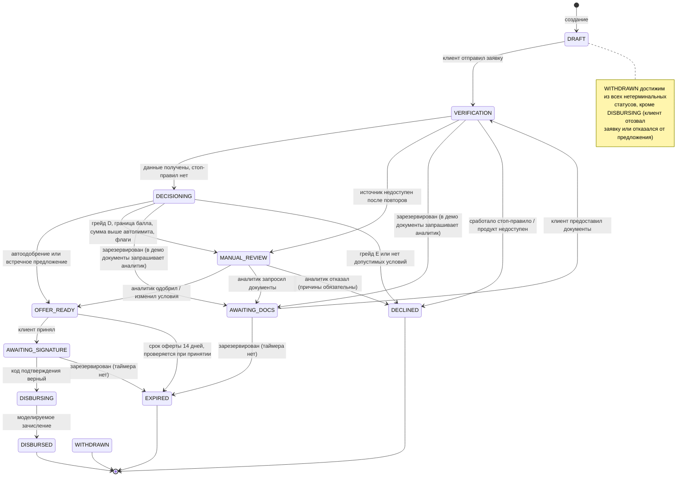

# Диаграмма состояний заявки

12 статусов, 26 разрешённых переходов. Источник истины — `app/states.py` (`TRANSITIONS`); тест `test_state_machine_is_closed` фиксирует состав.

Не все разрешённые переходы используются в демо. Заявку переводят в `AWAITING_DOCS` только аналитик (из `MANUAL_REVIEW`), а срок оферты проверяется в момент принятия. Переходы по сроку документов и подписания, а также автоматический запрос документов оставлены в таблице как заготовка, таймеров под них нет.

## Статус → что видит клиент

| Внутренний статус | Клиентский ярлык | Шаг степпера | Чей ход |
|---|---|---|---|
| DRAFT | Черновик | 1 Заявка | клиент |
| VERIFICATION | Проверяем данные | 2 Проверка | банк |
| AWAITING_DOCS | Нужны документы | 2 Проверка | **клиент** |
| DECISIONING | Оцениваем условия | 3 Решение | банк |
| MANUAL_REVIEW | Заявку рассматривает специалист | 3 Решение | банк |
| OFFER_READY | Предложение готово («Одобрено» / «Другие условия») | 3 Решение | **клиент** |
| AWAITING_SIGNATURE | Ожидает подписания | 4 Подписание | **клиент** |
| DISBURSING | Оформляем выдачу | 5 Выдача | банк |
| DISBURSED | Кредит выдан | 5 Выдача | — |
| DECLINED / WITHDRAWN / EXPIRED | Отказано / Заявка закрыта / Срок истёк | — | — |

Автоматические этапы (`VERIFICATION`, `DECISIONING`, `DISBURSING`) выполняет фоновый поток с паузой `STEP_DELAY_SEC`; клиентский интерфейс опрашивает сервер и меняет статус без перезагрузки.
